# Electricity Demand Forecasting

**Day-ahead hourly load forecasting for the PJM East grid, built as a complete ML system: weather-aware models, a leakage-safe evaluation protocol, hyperparameter tuning, multi-year backtesting, MLflow model management, a tested FastAPI service, and a simulated production lifecycle with monitoring, gated retraining, and automatic rollback.**


**Author:** Hamza Alaskri

The service forecasts electricity demand for each of the next **24 hours**. Its inputs are the last 30 days of hourly load, the calendar (including public holidays), and the temperature forecast for the four main load centres. It trains one gradient-boosted model per horizon.

On a held-out test set covering **2.5 years** (2016–2018), which the model never saw during training, tuning, or selection, it achieves the following. The temperature forecasts here carry **realistic forecast error**, not the observed temperatures:

| Test set, mean over 24 horizons | LightGBM | Best baseline (seasonal naive 24h) |
|---|---:|---:|
| **MAE** | **1,001 MW** | 2,208 MW |
| **RMSE** | **1,357 MW** | 3,031 MW |
| **MAPE** | **3.14 %** | 7.02 % |

That is **55 % lower error than the strongest baseline**. A **rolling-origin backtest over five separate years** confirms the result is stable: **MAPE 3.19 % ± 0.18 %**, beating the baseline by more than 50 % in every year. All numbers are produced by the pipeline and saved in [`reports/`](reports).

---

## Highlights

- **Weather-driven accuracy.** Adding hourly temperature (ERA5 reanalysis for Philadelphia, Newark, Baltimore, and Washington) cut the test MAE by **30 %** and the error during demand peaks by **29 %** compared with the calendar-and-lags-only version.
- **Honest about weather forecasts.** The model is evaluated with simulated temperature-forecast error that grows from 0.5 °C to 2 °C over the day. The upper bound with perfect temperatures (MAPE 2.57 %) is reported separately and never used as the headline.
- **No information leakage, enforced in code.**
  - Splits are chronological and **purged**: no target falls inside a later partition.
  - Early stopping and tuning use only the training partition.
  - The validation set only selects the model family.
  - The test set is scored exactly once.
  - Tests check that no feature changes when future values change.
- **Training and serving cannot drift apart.** The API builds its input with the same function as training, and a test asserts that the two rows are identical. A model exported on Windows was verified to give the same predictions on Linux (difference below 10⁻⁶ MW).
- **Full model lifecycle, demonstrated.** A day-by-day replay of 2.5 years runs data-quality gates, seasonally aware performance and drift monitoring, scheduled and alert-triggered retraining, a promotion gate, and automatic rollback. All of it is versioned in the MLflow registry.
- **Reproducible from one empty state.** Five commands rebuild everything: data download, tuning, training, backtest, and simulation. Tuning and training gave identical results on two independent runs.
- **Portable, lean artifacts.**
  - Estimators are stored in native gzipped formats (LightGBM text, XGBoost UBJ), never pickled.
  - The model is 78 MB. The whole experiment store (tuning, both candidates, the final model, the backtest, and four simulation versions) is 551 MB, down from 9.9 GB.
  - The Docker image uses `mlflow-skinny` and installs only the selected model's library: 909 MB, down from 1.44 GB.
- **Tested and verified.**
  - 79 tests cover data, weather, features, splitting, metrics, model serialization, the training pipeline end to end, monitoring policies, every API path, and the real model.
  - CI was verified in a clean Linux container.
  - The Docker image was built and exercised: readiness-gated HEALTHCHECK, non-root user.

---

## Contents

- [Results](#results)
- [Rolling-origin backtest](#rolling-origin-backtest)
- [Production simulation](#production-simulation)
- [Exploratory analysis](#exploratory-analysis)
- [Methodology](#methodology)
- [Architecture](#architecture)
- [Quickstart](#quickstart)
- [API](#api)
- [Project structure](#project-structure)
- [Testing](#testing)
- [Limitations](#limitations)

---

## Results

### Test set (2016-02-09 → 2018-08-02, 21,698 forecast origins)

The final LightGBM model is refit on train + validation and scored once:

| Method | MAE (MW) | RMSE (MW) | MAPE |
|---|---:|---:|---:|
| **LightGBM, forecast temperatures (realistic)** | **1,001.1** | **1,356.7** | **3.14 %** |
| LightGBM, observed temperatures (upper bound) | 813.6 | 1,085.1 | 2.57 % |
| Seasonal naive (24h) | 2,208.2 | 3,030.9 | 7.02 % |
| Seasonal naive (168h) | 3,438.0 | 4,741.3 | 10.71 % |
| Naive (last value) | 4,613.4 | 5,861.2 | 15.06 % |

MAE by forecast horizon (MW):

| Horizon | LightGBM | Naive | Seasonal naive 24h | Seasonal naive 168h | Improvement over best baseline |
|---:|---:|---:|---:|---:|---:|
| 1 h | **221.3** | 1,054.5 | 2,207.9 | 3,438.4 | 79 % |
| 6 h | **801.3** | 5,079.7 | 2,208.0 | 3,438.3 | 64 % |
| 12 h | **1,048.8** | 6,130.8 | 2,208.1 | 3,438.1 | 53 % |
| 18 h | **1,255.3** | 5,330.2 | 2,208.3 | 3,437.9 | 43 % |
| 24 h | **1,323.9** | 2,208.7 | 2,208.7 | 3,436.9 | 40 % |

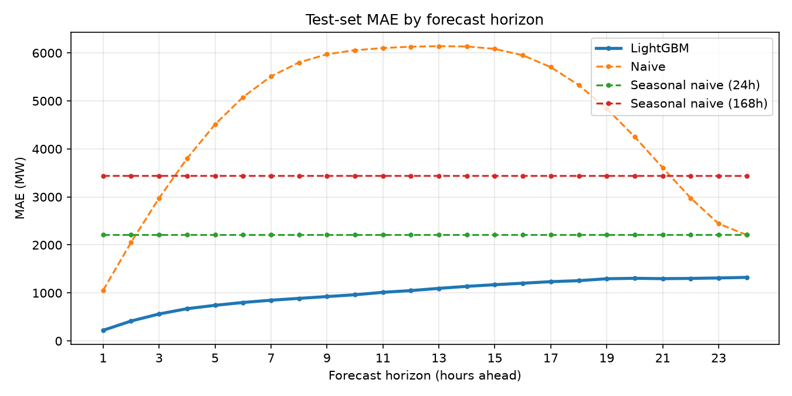

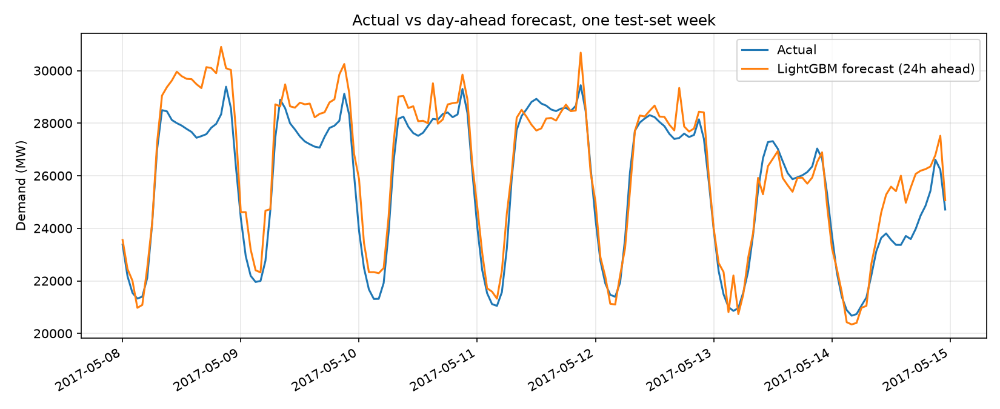

### Impact of adding weather (same split, same test set)

| Test set | v1: lags + calendar | v2: + temperature + holidays | Change |
|---|---:|---:|---:|
| Mean MAE | 1,421 MW | **1,001 MW** | −30 % |
| MAE at 24 h | 1,817 MW | **1,324 MW** | −27 % |
| MAE during peaks (top 10 %) | 2,374 MW | **1,675 MW** | −29 % |
| Mean bias during peaks | +1,345 MW | **+461 MW** | −66 % |
| 95th-percentile error | 4,234 MW | **2,964 MW** | −30 % |

### Model selection (validation set, 2013-08-19 → 2016-02-08)

LightGBM and XGBoost were tuned with the same budget and early-stopped on the same data. The family with the lower mean validation MAE was selected automatically:

| Method | Mean MAE (MW) | Mean RMSE (MW) | MAPE | MAE @ 1h | MAE @ 24h |
|---|---:|---:|---:|---:|---:|
| **LightGBM** ✔ | **834.8** | **1,095.7** | **2.62 %** | 216.6 | **918.4** |
| XGBoost | 840.2 | 1,102.9 | 2.64 % | **212.8** | 921.4 |
| Seasonal naive (24h) | 2,241.4 | 3,061.8 | 7.00 % | 2,242.1 | 2,239.4 |

The two families are within 1 %. XGBoost scored slightly better on the tuning objective, but LightGBM was better on validation. Because selection uses only validation, LightGBM was deployed.

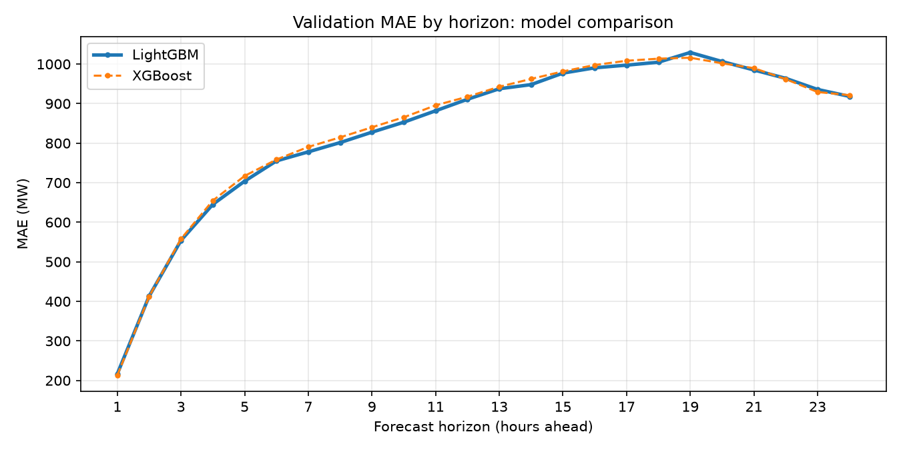

### Hyperparameter tuning

Optuna (TPE sampler, median pruning, 25 trials per family) ran on the training partition only. Models were early-stopped on the first half of the training tail and scored on its second half, at horizons 1, 12, and 24 h. The current defaults are always the first trial.

| Family | Default objective MAE | Tuned objective MAE | Gain |
|---|---:|---:|---:|
| LightGBM | 626.7 | 622.8 | 0.6 % |
| XGBoost | 631.2 | 619.6 | 1.8 % |

The gains are small. The original settings were already close to optimal, and the large improvement came from better inputs (weather), not from tuning. The tree cap was raised to 5,000, and no horizon reaches it (801–4,313 trees).

### Error analysis (test set, all horizons pooled)

| Finding | Value |
|---|---|
| Hardest hours | 13:00–19:00, a flat plateau (worst: 14:00, MAE 1,279 MW) |
| Easiest hours | 03:00–05:00 (best: 04:00, MAE 684 MW) |
| MAE when demand is above / below the median | 1,242 MW / 760 MW |
| MAE during peaks (top 10 %, ≥ 40,154 MW) | 1,675 MW |
| Peak hours under-forecast | 60 % (mean bias +461 MW; was 71 % and +1,345 MW without weather) |
| 95th percentile absolute error | 2,964 MW |

| Error by hour of day | Error by demand level |
|---|---|
| 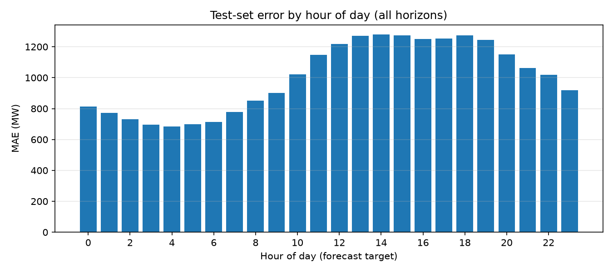 | 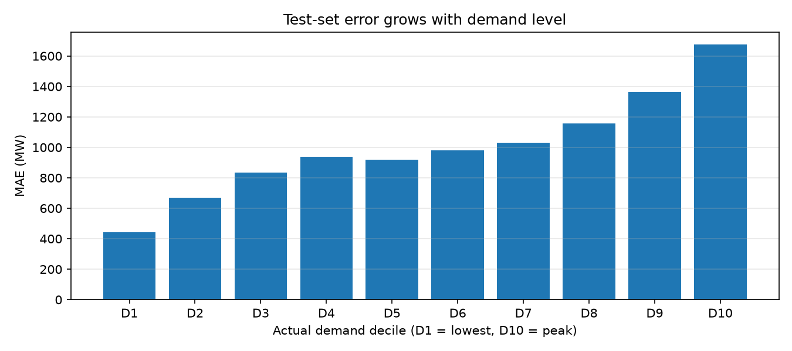 |

### What the models learn

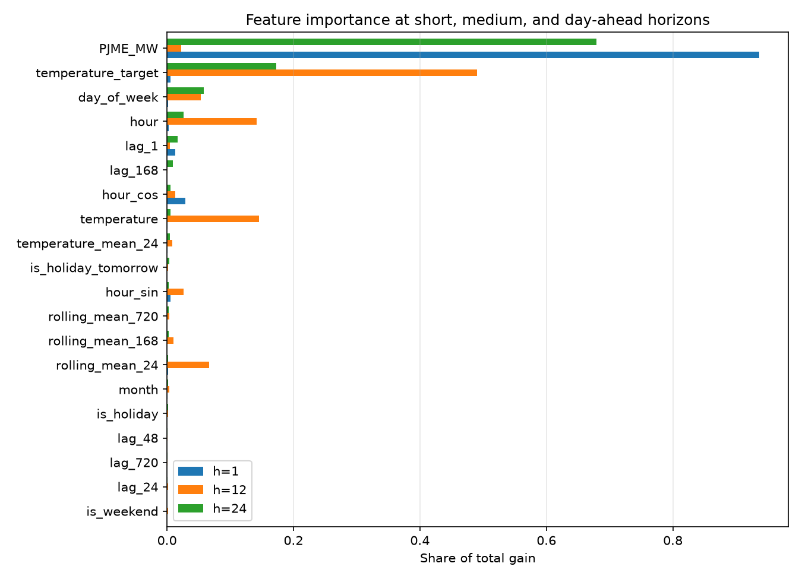

- **1 hour ahead:** the latest reading dominates.
- **12 hours ahead:** the target lies in the opposite half of the daily cycle, so the model leans on the **temperature forecast for the target hour**, the hour of day, and the recent daily level.
- **24 hours ahead:** the same hour yesterday and the target-hour temperature carry most of the signal.

---

## Rolling-origin backtest

A single test window can be lucky. For each year from 2014 to 2018, the model is retrained from scratch on everything before 1 January (purged and early-stopped) and scored on that year, with realistic temperature forecasts:

| Test year | Training rows | MAE (MW) | MAPE | Seasonal naive 24h MAE | Improvement |
|---|---:|---:|---:|---:|---:|
| 2014 | 104,423 | 937.7 | 2.93 % | 2,348.9 | 60 % |
| 2015 | 113,183 | 1,040.1 | 3.23 % | 2,188.1 | 52 % |
| 2016 | 121,943 | 1,019.0 | 3.18 % | 2,088.1 | 51 % |
| 2017 | 130,727 | 992.4 | 3.16 % | 2,162.9 | 54 % |
| 2018 (Jan–Aug) | 139,487 | 1,105.0 | 3.42 % | 2,532.1 | 56 % |
| **Mean ± std** | | **1,018.8 ± 61.6** | **3.19 ± 0.18 %** | | **55 %** |

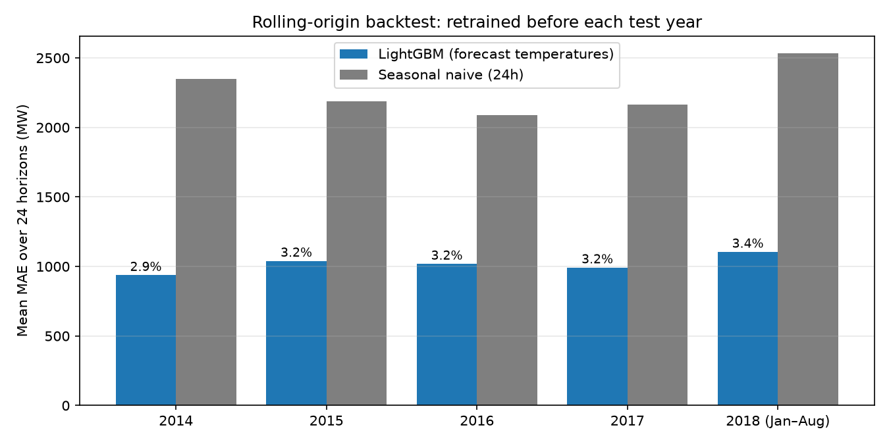

---

## Production simulation

`python -m src.monitor` replays the whole test period (**905 days**, February 2016 to August 2018) as if the system were live. Every evening at 23:00 the current champion forecasts the next day using realistic temperature forecasts. Once the actual values arrive, the following policies run:

| Stage | Policy |
|---|---|
| **Data-quality gate** | Missing, non-positive, flat-lined (≥ 6 h), or implausibly jumping (> 35 %/h) readings block the forecast instead of producing a silently wrong one |
| **Performance monitoring** | 28-day MAE relative to the seasonal-naive baseline on the same days. This ratio cancels the seasonal swing in absolute error, so a hot summer is not mistaken for decay. Alert when it stays 20 % above its reference (0.445, measured on validation with forecast temperatures) for 7 days |
| **Drift monitoring** | PSI of temperature and demand over 28 days vs the **same days of the year** in the champion's training data, with hysteresis (raise > 0.25, clear < 0.15). Drift is reported but never replaces a model on its own |
| **Retraining** | On a performance alert or every 180 days, at most once per 60 days. The candidate is trained on data up to 28 days before the decision |
| **Promotion gate** | Champion and candidate are both scored on those last 28 days (unseen by the candidate). Deploy only if the candidate is **≥ 1 % better** |
| **Rollback** | The previous champion runs in shadow for 14 days. Roll back automatically if the new one is **> 5 % worse** over at least 7 days |

Two **clearly labelled faults are injected** to show the safeguards working (disable with `--no-faults`):
- a 3-day meter outage;
- a manual "hotfix" that bypasses the gate with a model trained on readings mis-calibrated by +8 %.

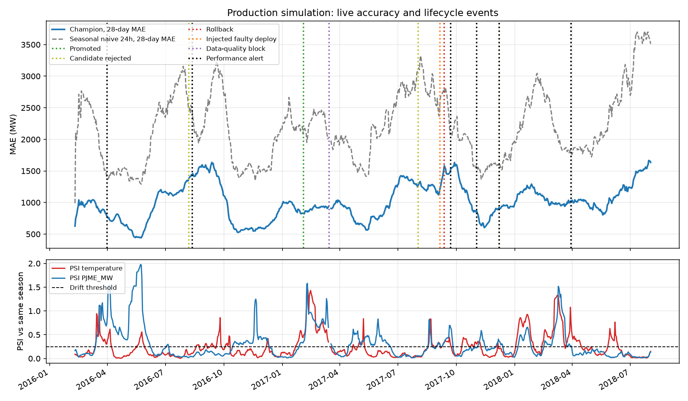

What happened:

| Date | Event | Detail |
|---|---|---|
| 2016-08-07 | Candidate rejected | Scheduled retrain: 1,462 vs 1,460 MW, no gain |
| 2017-02-03 | **Promoted v2** | Scheduled retrain: 848 vs 871 MW (−2.6 %); confirmed after 14 days in shadow |
| 2017-03-15 → 17 | Data-quality block ×3 | Injected outage: 24 missing readings per day, forecasts withheld |
| 2017-08-02 | Candidate rejected | 1,355 vs 1,358 MW, below the 1 % threshold |
| 2017-09-05 | Injected faulty deploy (v3) | Gate bypassed on purpose |
| 2017-09-12 | **Automatic rollback to v2** | v3 MAE 2,598 MW vs 665 MW for v2 in shadow, caught after 7 days |
| 2017-12-07 | Candidate rejected | Performance alert, but the candidate was no better (800 vs 800 MW) |
| 2018-03-30 | **Promoted v4** | Performance-alert retrain: 924 vs 955 MW (−3.2 %); confirmed after 14 days |

Over the 902 forecast days, the live MAE was **1,017 MW, 54 % better than the baseline**, even including the injected faulty week. That matches the offline test result (1,001 MW). The 2017-09-22 performance alert is the after-effect of the faulty week still sitting inside the 28-day window. Several retrains were rejected: the gate deploys only models that are measurably better. Every version is in the MLflow registry as `ElectricityDemandForecaster-simulation` v1–v4 (`@champion` = v4, `@previous` = v2), separate from the production lineage. Daily metrics and events are in [`reports/monitoring/`](reports/monitoring).

---

## Exploratory analysis

| | |
|---|---|
| 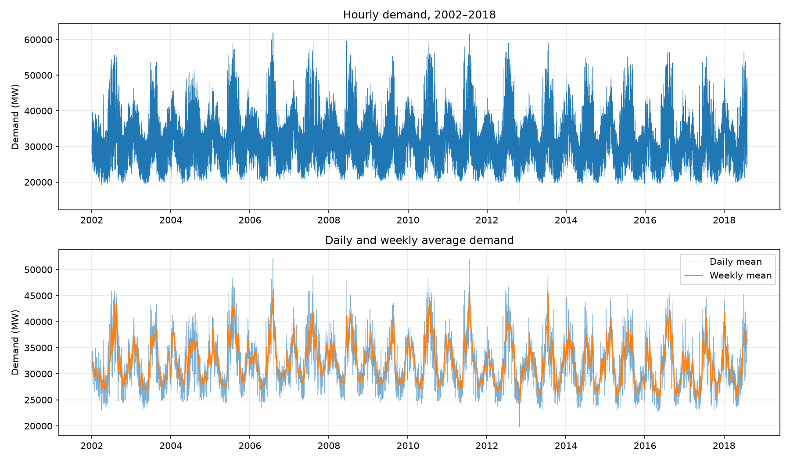 | 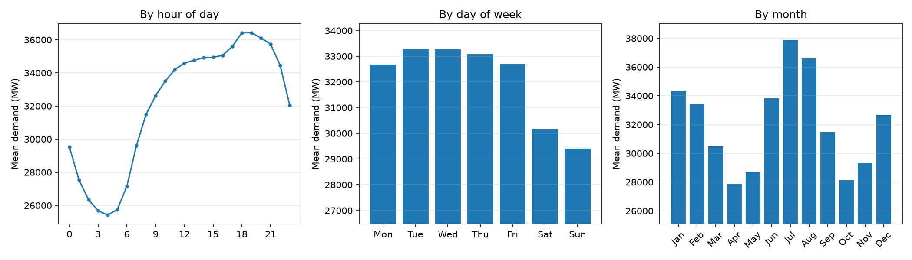 |
| 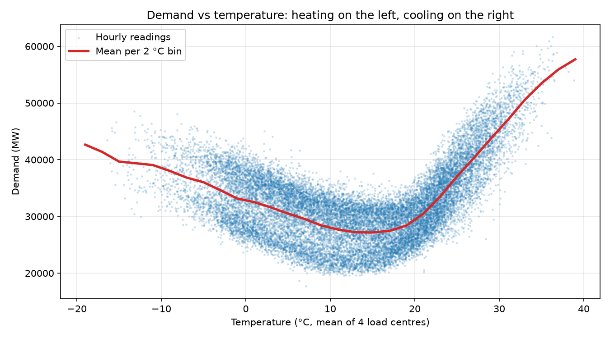 | 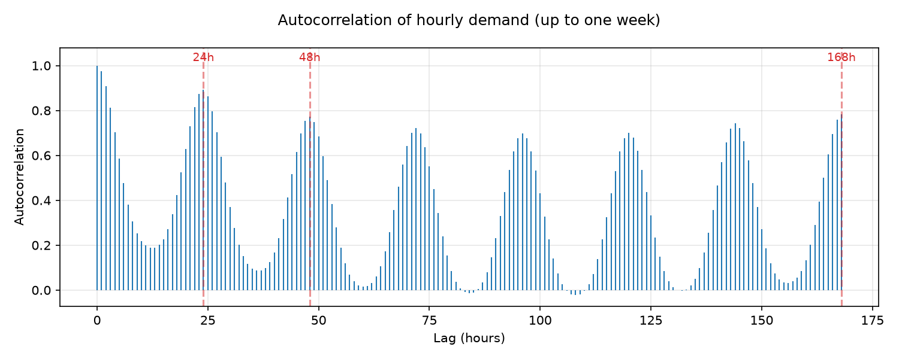 |

- **Temperature is the dominant driver.** Demand follows a U-shape against temperature: heating on the left, air conditioning on the right. The correlation between demand and temperature is **0.89 in July–August**.
- **Daily cycle:** demand bottoms out around 04:00 and peaks around 18:00–19:00.
- **Weekly cycle:** demand on weekends is about 10 % lower than on weekdays.
- **Peak hours:** the top 1 % of hours (at least 51,155 MW) fall almost entirely in June to August (see `eda_peaks_by_month.png`).
- **Autocorrelation:** strong peaks every 24 hours and a rise again at 168 hours, which justifies the 24 h, 48 h, and 168 h lags.

---

## Methodology

### 1. Data

| Source | Details |
|---|---|
| Demand | [PJM Hourly Energy Consumption](https://www.kaggle.com/datasets/robikscube/hourly-energy-consumption), PJM East (`PJME_MW`). 145,366 rows (2002–2018): 4 DST duplicates averaged and 30 DST gaps interpolated, giving 145,392 strictly hourly points. |
| Temperature | ERA5 reanalysis 2 m temperature from the [Open-Meteo archive API](https://open-meteo.com/en/docs/historical-weather-api). Equal-weight mean of Philadelphia, Newark, Baltimore, and Washington, converted from UTC to local time and regularized the same way as demand (`python -m src.weather`). |
| Holidays | US federal holiday calendar (pandas). |

Validation rejects missing columns, non-numeric or non-positive demand, implausible temperatures, and gaps longer than 3 hours.

### 2. Features

Each forecast origin *t* has 19 shared features and 24 temperature forecasts. The horizon-*h* model sees the 19 shared features plus `temperature_target`, the forecast for hour *t + h*.

| Group | Features | Motivation |
|---|---|---|
| Demand level | `PJME_MW`, `lag_1`, `lag_24`, `lag_48`, `lag_168`, `lag_720` | ACF peaks at 24 h and 168 h; 720 h adds monthly context |
| Rolling | `rolling_mean_24`, `rolling_mean_168`, `rolling_mean_720` | Recent demand level over a day, week, and month |
| Calendar | `hour`, `day_of_week`, `month`, `is_weekend`, `hour_sin`, `hour_cos` | Daily, weekly, and seasonal regimes |
| Holidays | `is_holiday`, `is_holiday_tomorrow` | Holidays behave like weekends, and the target may fall on the next day |
| Weather | `temperature`, `temperature_mean_24`, `temperature_target` | Heating and cooling demand; thermal inertia of buildings |

Every demand and calendar feature uses only information available at *t*.

**Temperature forecasts are handled transparently.** During training, `temperature_target` is the observed temperature at *t + h*, the standard "perfect forecast" setup. At evaluation time it is replaced by a **simulated forecast**: the observed value plus an error whose standard deviation grows from 0.5 °C (1 h ahead) to 2 °C (24 h ahead). The error has a shared component, so a forecast that runs warm tends to run warm all day. This is how the realistic headline numbers are measured. In production, the API receives a real weather forecast.

### 3. Forecasting strategy

**Direct multi-horizon:** 24 independent regressors, where model *h* predicts demand at *t + h*. Errors do not compound across horizons, each horizon gets its own tree count, and each sees the temperature forecast for its own target hour.

### 4. Evaluation protocol

```
|<-------------------- train (70 %) -------------------->|<-- validation (15 %) -->|<---- test (15 %) ---->|
|<----------- fit ----------->|gap|<-- early stopping -->|gap|                      |gap|                    |
  2002-01 ............ 2012-06     2012-06 ..... 2013-08     2013-08 ...... 2016-02     2016-02 ..... 2018-08
```

1. **Purging:** each partition ends 24 hours early (`gap`), so no target of one partition falls inside the next.
2. **Tuning:** uses only the training partition, splitting the early-stopping tail into an early-stopping half and a scoring half.
3. **Fit / early stopping:** candidates are fitted on `fit` and early-stopped on `early stopping`.
4. **Selection:** LightGBM vs XGBoost is decided on the validation partition, which plays no part in fitting or tuning.
5. **Final model:** the selected family is refit on train + validation with the tree counts from step 3.
6. **Test:** scored once, with realistic temperature forecasts, together with the baselines on the same origins.
7. **Backtest:** steps 3 and 6 are repeated per year with an expanding window (see above).

### 5. Experiment tracking and model registry

```text
experiment: electricity-demand-forecasting
├── hyperparameter_tuning             best params + full trial history for both families
├── training_pipeline                 data-quality + split metadata, summary metrics for every method
│   ├── LightGBM_24h_candidate        params, tree count per horizon, validation curves, 24-horizon model
│   ├── XGBoost_24h_candidate         (same)
│   └── LightGBM_24h_final            test metrics and curves, reports + figures, registered model
├── rolling_origin_backtest           per-year metrics and figure
└── production_simulation             live metrics per day, lifecycle events, simulated registry versions

registry: ElectricityDemandForecaster              v1  @champion
          ElectricityDemandForecaster-simulation   versions created by the simulation (@champion, @previous)
```

The registered model is a PyFunc wrapper around 24 estimators stored in native formats. The pickle holds only a reference to the wrapper class (under 10 KB, no model state). The wrapper ships with its source code, input signature, input example, and pinned requirements. The same model is exported to `models/electricity_demand_forecaster/` for the API and the Docker image.

---

## Architecture

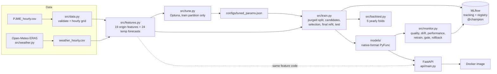

---

## Quickstart

Requires **Python 3.14** (tested) and Docker for the container.

```bash
python -m venv .venv
# Windows: .venv\Scripts\activate    macOS/Linux: source .venv/bin/activate
pip install -r requirements-dev.txt
```

The full pipeline, from an empty state (timings on a desktop CPU):

```bash
python -m src.weather     # download hourly temperature (~20 s)
```

```bash
python -m src.tune        # tune both families (~25 min, optional: defaults are used otherwise)
```

```bash
python -m src.train       # train, select, test, export, register (~10 min)
```

```bash
python -m src.backtest    # five yearly folds (~15 min)
```

```bash
python -m src.monitor     # replay 2.5 years of production (add --no-faults to skip injected faults)
```

Browse the experiments:

```bash
mlflow ui --backend-store-uri sqlite:///mlflow.db
```

Run the API locally:

```bash
uvicorn api.main:app --port 8001
```

Build and run the container (after `src.train` has produced `models/`):

```bash
docker build -t electricity-forecast-api .
```

```bash
docker run -d --name electricity-api -p 8001:8001 electricity-forecast-api
```

Serve the registry's champion instead of the local export (requires the full `mlflow` package):

```bash
MLFLOW_TRACKING_URI=sqlite:///mlflow.db MODEL_URI=models:/ElectricityDemandForecaster@champion uvicorn api.main:app --port 8001
```

---

## API

| Method | Endpoint | Description |
|---|---|---|
| `GET` | `/health` | Liveness and status (`ok` or `degraded`); always answers |
| `GET` | `/ready` | Readiness: `503` until the model is loaded (used by the Docker `HEALTHCHECK`) |
| `GET` | `/model` | Model version, URI, expected features, horizon, training metadata |
| `POST` | `/predict` | 24 hourly forecasts |

`POST /predict` accepts two kinds of request:

- **`{}`:** forecast from the latest bundled data (demand and temperature), cleaned exactly as in training.
- **Custom inputs:** all four fields together:

```json
{
  "history": [31250.0, 30480.5, "... at least 721 hourly MW values, oldest first ..."],
  "last_timestamp": "2018-08-03T00:00:00",
  "temperature_history": [24.1, 23.8, "... at least 24 hourly °C values ending at last_timestamp ..."],
  "temperature_forecast": [23.5, 23.2, "... exactly 24 hourly °C values for the next 24 hours ..."]
}
```

Response (abbreviated):

```json
{
  "model_name": "ElectricityDemandForecaster",
  "model_version": "local",
  "last_observation": "2018-08-03T00:00:00",
  "forecast_horizon": 24,
  "unit": "MW",
  "forecast": [
    { "horizon": 1, "timestamp": "2018-08-03T01:00:00", "demand_mw": 32695.35 },
    "..."
  ]
}
```

| Status | When |
|---|---|
| `200` | Forecast returned |
| `422` | Invalid input: wrong lengths, non-numeric, non-positive demand, temperature outside −50…60 °C, or an incomplete set of custom fields |
| `503` | Model not loaded |
| `500` | Unexpected model failure (details logged server-side, not leaked to clients) |

In the verified container, raising the 24-hour temperature forecast from 28 °C to 34 °C for a summer day lifts the forecast peak from 35,951 to 43,786 MW, the physically expected response.

---

## Project structure

```text
electricity-demand-forecasting/
├── src/
│   ├── config.py          # Paths, features, horizons, default params, monitoring policy
│   ├── data.py            # Loading, validation, DST handling, regular hourly grid
│   ├── weather.py         # Temperature download (Open-Meteo ERA5) and validation
│   ├── features.py        # Feature/target construction shared by training and API
│   ├── evaluation.py      # Purged chronological split, baselines, metrics
│   ├── modeling.py        # Dataset assembly, direct multi-horizon fitting, forecast-error simulation, export
│   ├── model.py           # PyFunc wrapper + native (gzipped) estimator serialization
│   ├── tune.py            # Optuna tuning (CLI)
│   ├── train.py           # Training pipeline (CLI)
│   ├── backtest.py        # Rolling-origin backtest (CLI)
│   ├── monitor.py         # Production simulation: monitoring, retraining, gate, rollback (CLI)
│   └── plots.py           # EDA and report figures
├── api/main.py            # FastAPI app (app factory, typed schemas, readiness probe)
├── tests/                 # 79 tests (see below)
├── notebooks/01_dataset_audit.ipynb   # Dataset selection, audit, EDA, model prototyping
├── configs/tuned_params.json          # Tuning result (input to training)
├── reports/               # metrics.json, backtest.json, monitoring/, figures/
├── data/                  # PJME_hourly.csv, weather_hourly.csv, archive.zip (dataset selection)
├── Dockerfile, .dockerignore
├── .github/workflows/ci.yml
├── requirements.txt       # API runtime (mlflow-skinny)
├── requirements-dev.txt   # Training, tuning, analysis, tests
└── pyproject.toml
```

---

## Testing

```bash
pytest
```

| Suite | What it guarantees |
|---|---|
| `test_data.py` | DST duplicates averaged, single gaps interpolated, long gaps rejected, schema and value validation |
| `test_features.py` | Lags, rolling windows, temperature forecasts, and holidays are correct; no future demand in features; **training/inference parity** |
| `test_evaluation.py` | Split is chronological and purged; baselines only use past values; metric arithmetic |
| `test_modeling.py` | Forecast-error simulation (only forecasts change, error grows with horizon, reproducible); weather validation |
| `test_model.py` | Wrapper column order and feature checks; **native-format round trip** for LightGBM and XGBoost preserves predictions |
| `test_train.py` | Full pipeline on synthetic data: reports, figures, purged partitions, MLflow runs, `@champion` alias, registry model = exported model, **OS-portable artifact** |
| `test_monitor.py` | PSI, data-quality checks, performance alert, promotion gate, rollback rule |
| `test_plots.py` | EDA figures render |
| `test_api.py` | Every endpoint and error path (422 / 500 / 503, readiness) using a stub model |
| `test_integration.py` | Real model through the API: loads, plausible forecasts, hotter forecast raises summer demand |

CI (`.github/workflows/ci.yml`) installs `requirements-dev.txt` on Ubuntu with Python 3.14 and runs the suite. The same steps were run in a clean `python:3.14-slim` container: 76 passed, and the 3 integration tests were skipped because trained artifacts are not in git.

---

## Limitations

- **Simulated, not archived, weather forecasts.** The realistic numbers use observed temperature plus a calibrated error model, not archived historical forecasts. Real NWP errors are larger during fast weather changes.
- **Reanalysis temperature.** ERA5 is a gridded reanalysis, not station data. Station data, humidity, and cloud cover could improve summer peaks further.
- **Live data feed.** The default request forecasts from the bundled files, which end in August 2018. A live deployment would call the API's custom-input mode from a scheduler fed by PJM Data Miner (which needs an API key) and a weather-forecast provider. `DATA_PATH` and `WEATHER_PATH` can point at refreshed files.
- **Point forecasts only.** Prediction intervals (quantile objectives) would help grid operators size reserves.
- **Single region.** Other PJM zones would need their own weather points.

---

## Data source

PJM hourly load comes from the public Kaggle dataset [*Hourly Energy Consumption*](https://www.kaggle.com/datasets/robikscube/hourly-energy-consumption), originally published by PJM Interconnection. Temperature comes from [Open-Meteo](https://open-meteo.com/) (ERA5, CC BY 4.0). Check each source's terms before redistributing the raw files.

---

## Author

**Hamza Alaskri**
